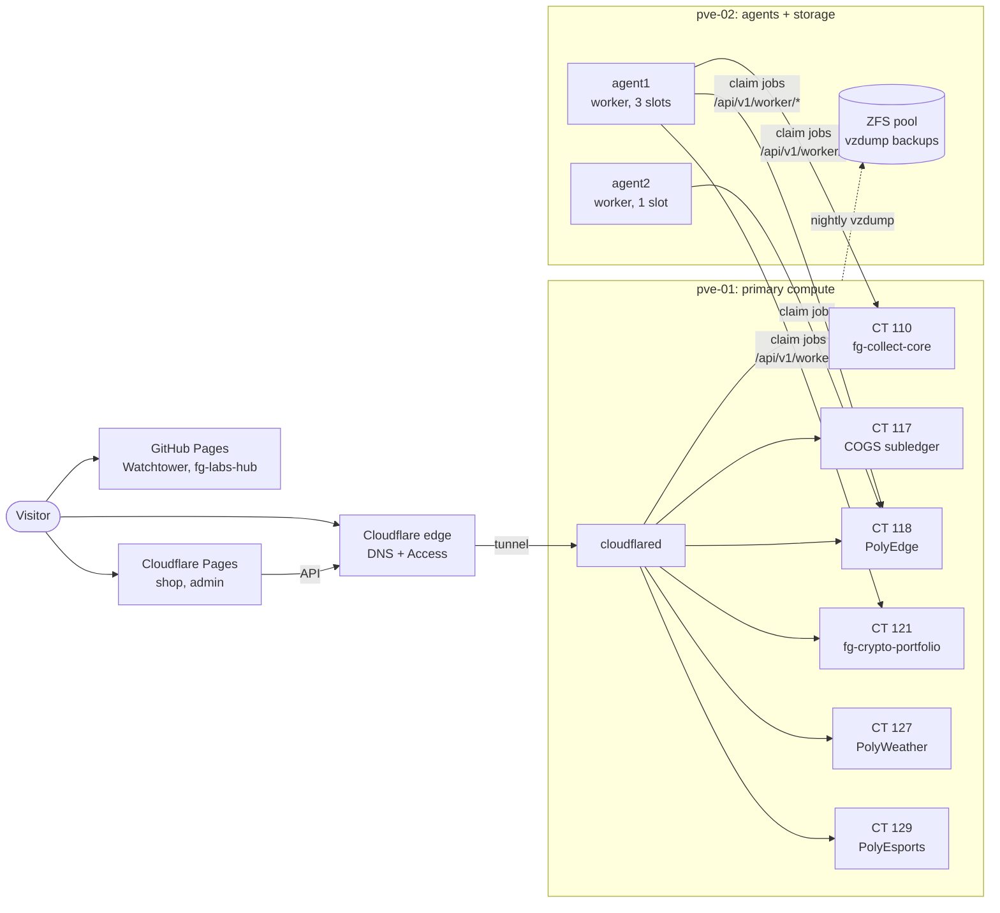
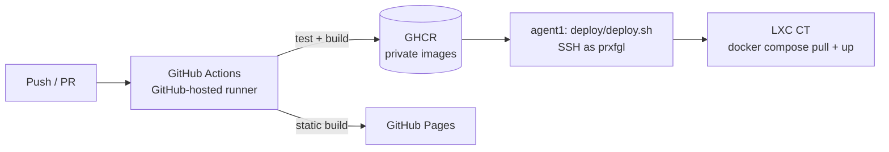
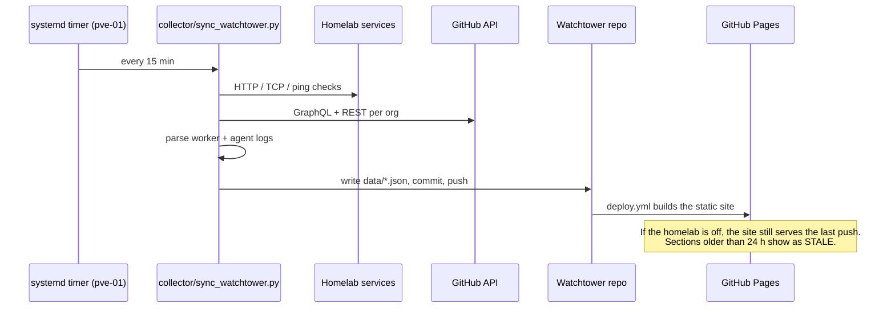

# Homelab architecture

Everything public reaches the homelab through one Cloudflare tunnel. Nothing listens on the home
router. App servers live in LXC containers on the Proxmox cluster and run Docker Compose. Static
frontends are on GitHub Pages or Cloudflare Pages, so they keep working when the homelab is off.

> Sample data. Hostnames and CT numbers come from the workspace notes. Hardware specs are
> placeholders until the collector reports real values.

## Topology

## CI/CD

## Watchtower data flow

## Nodes

| Node | Role | CPU | RAM | Storage | Guests |
|---|---|---|---|---|---|
| pve-01 | primary compute | Ryzen 9 7950X, 16c/32t | 128 GB | 4 TB NVMe (ZFS mirror) | CT 110, 117, 118, 121, 127, 129, cloudflared |
| pve-02 | agents + storage | i5-12500, 6c/12t | 64 GB | 12 TB ZFS RAIDZ1 | agent1, agent2, backups |

## Project stacks

| Project | Org | Stack | Runs on | Deploy |
|---|---|---|---|---|
| fg-collect-core | FG-CollectShop | Go, PostgreSQL, agent job queue | CT 110 | GHCR, deploy.sh |
| fg-collect-admin | FG-CollectShop | Vite, React, TypeScript | Cloudflare Pages | Pages on push |
| fg-collect-infra | FG-CollectShop | Terraform, Cloudflare, Proxmox provider | n/a | manual `terraform apply` |
| fg-price-scout | FG-CollectShop | Python, worker jobs | CT 110 (cron) | GHCR |
| fg-crypto-portfolio | FG-CryptoLabs | Python, FastAPI, SQLite | CT 121 | GHCR, deploy.sh |
| fg-labs-hub | FG-CryptoLabs | Hugo, `data/projects.yaml` | GitHub Pages | Pages on push |
| polyedge / polyarbs | FG-PolyLabs | Python, Postgres, Docker Compose | CT 118 | GHCR, deploy.sh |
| polyweather | FG-PolyLabs | Python, Postgres | CT 127 | GHCR, deploy.sh |
| polyesports | FG-PolyLabs | Python, Postgres | CT 129 | GHCR, deploy.sh |
| tcg-cogs-subledger | FGL-Services | Python, Postgres | CT 117 | deploy.sh |
| fgl-watchtower | FutureGadgetLabs-Watchtower | Vite, React, Tailwind; Python collector | GitHub Pages + pve-01 timer | Pages on push |

## Conventions

- **AI goes through the worker pool.** Apps queue a job with a prompt, a JSON schema and a model.
  agent1 and agent2 claim jobs over `/api/v1/worker/*`. No app server holds an LLM key.
- **Auth.** Public routes on the tunnel sit behind a Google sign-in allowlist.
- **Backlog.** GitHub issues labelled `backlog`, in private repos only.
